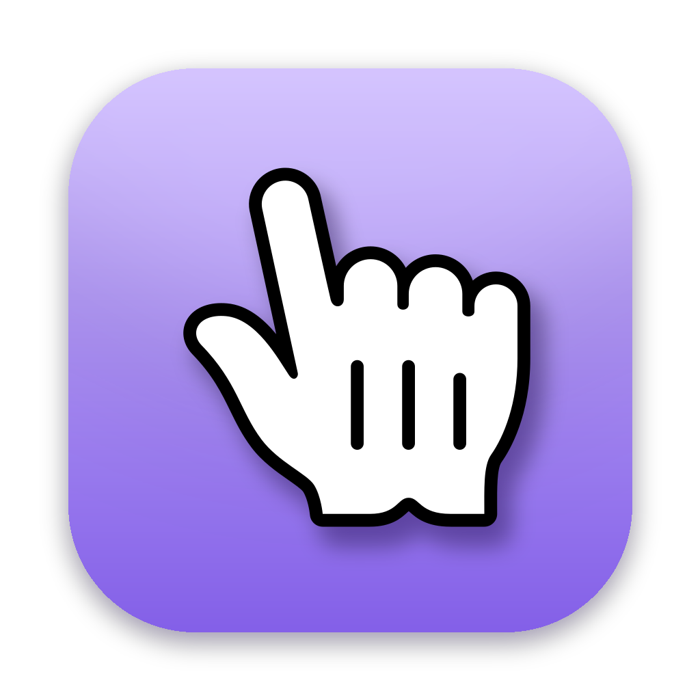

<p align="center"></p>

<h1 align="center">TinyHand</h1>

<p align="center">A toy pointer for your screen recordings. A little hand on a stick follows your cursor, taps when you click, and draws when you drag.</p>

## Install

Download the latest `TinyHand-x.y.z.dmg` from [Releases](../../releases), open it and drag
TinyHand to Applications. On first launch, allow **Accessibility** when macOS asks
(System Settings → Privacy & Security → Accessibility). TinyHand needs it to turn your
clicks into taps instead of real clicks.

Requires macOS 13 or later.

## Use

| | |
|---|---|
| Click the menu bar icon, or **⌃⌥H** | Turn the pointer on or off |
| Right-click the menu bar icon | Menu and Settings |
| Click | Tap (nothing underneath gets clicked) |
| Hold and drag | Draw on the screen |
| **⌃⌥X** | Clear the drawing |
| **Esc** | Clear everything and turn the pointer off |

While the pointer is on, a small toolbar at the bottom of the screen lets you pick a
hand or a laser dot, mute the tap sound, or exit. It fades away while you record.

Settings let you change the shortcuts, pointer size, shadow, how long drawings stay,
tap sound, and whether TinyHand opens when you log in. TinyHand updates itself.

## Build

```sh
./scripts/build-app.sh && open dist/TinyHand.app
```

See [DEVELOPMENT.md](DEVELOPMENT.md) for releasing and how it works.

Icons by [Icons8](https://icons8.com).
