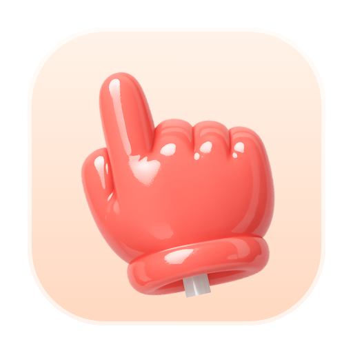
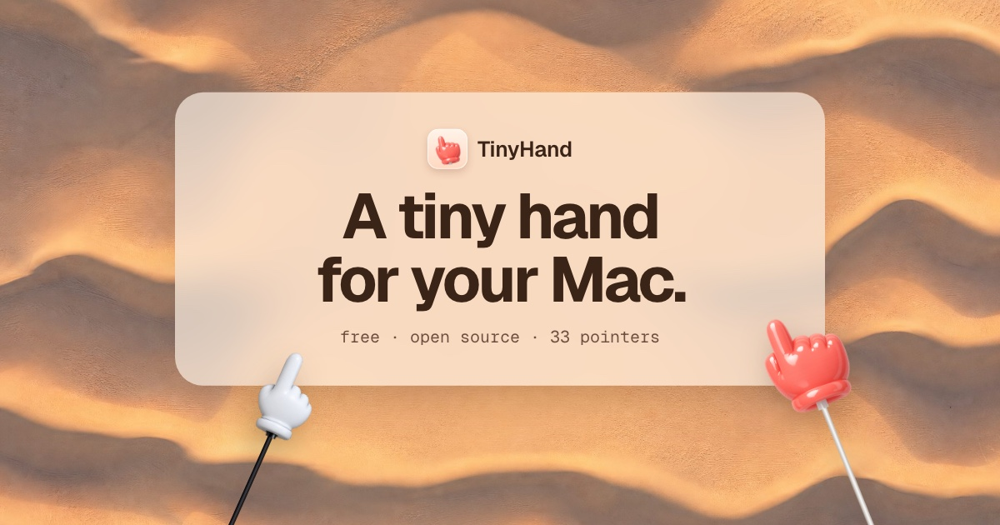

# TinyHand

A tiny hand on a stick that points at things on your Mac screen.

macOS 13 or later, Apple Silicon and Intel.

## Install

Open `TinyHand.dmg`, drag TinyHand to Applications and allow **Accessibility** when asked. It needs that to turn your clicks into taps. TinyHand updates itself.

## Use

| | |
|---|---|
| Click the menu bar icon, or **⌃⌥H** | Turn the pointer on or off |
| Right-click the menu bar icon | Menu and Settings |
| Click | Tap (nothing underneath gets clicked) |
| Hold and drag | Draw on the screen |
| **⌃⌥X** | Clear the drawing |
| **Esc** | Clear everything and turn the pointer off |

While the pointer is on, a small toolbar at the bottom of the screen lets you pick one of
36 hands or a laser dot, mute the tap sound, or exit.

## License

MIT. See [LICENSE](LICENSE).
